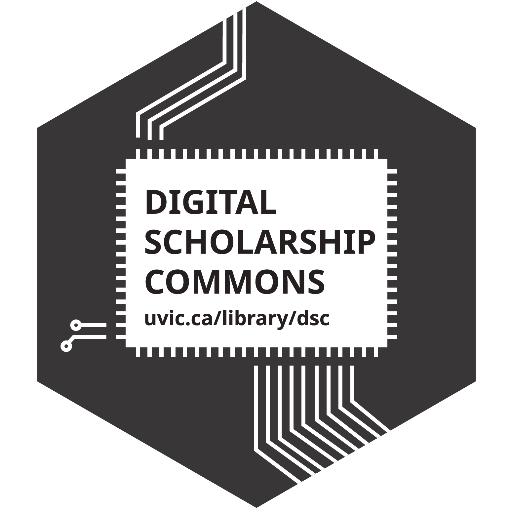

# DSC Workshop Lesson Plans

Check out our full list of [**upcoming scheduled workshops**](https://libcal.uvic.ca/calendar/dsc?cid=7692&t=g&d=0000-00-00&cal=7692&inc=0){:target="_blank"}! If you have any questions about our workshops or are an instructor wanting to have us run one of our workshops in connection with your course, feel free to [send us an email](mailto:rmccue@uvic.ca?Subject=Workshop%20Request){:target="_blank"}. If you would like to be kept up to date with DSC announcements, including new workshops, you can sign up for our [low-volume email list here](https://e1.envoke.com/ext/pages/7ca0996db17fcc4be7f60392f6790490){:target="_blank"}.

Below are self-drected workshops that the DSC has made available for anyone in the world to use free of charge!  

---

{::nomarkdown}

  <label for="dsc-workshop-search-input" class="dsc-filter-label">Filter workshops on this page:</label>
  

    <input type="search" id="dsc-workshop-search-input" class="dsc-search-input" placeholder="e.g., spreadsheet, Python, Canva..." autocomplete="off" spellcheck="false" />
    <button type="button" id="dsc-clear-button" class="dsc-clear-btn" aria-label="Clear filter search">Clear</button>
  

  

{:/nomarkdown}

> ## Jump to a Workshop Category:
> - [Data Analysis, Visualization, Mapping & GIS](#data)
> - [Design & Media Production](#design)
> - [AI Workshop Pathway](#ai)
> - [Fabrication & Electronics](#fabrication)
> - [Research & Data Literacy Skills](#research)
> - [Archived Workshops](#archived)

---

## Data Analysis, Visualization, Mapping & GIS
- [Data Analysis with Excel](https://lib.uvic.ca/xls){:target="_blank"}
- [RStudio Summary Statistics Introduction](https://lib.uvic.ca/rstud){:target="_blank"} 
- [RStudio Data Manipulation & Visualization Introduction](https://lib.uvic.ca/rvis){:target="_blank"} 
- [RStudio Data Analysis Intermediate](https://lib.uvic.ca/rintr){:target="_blank"}
- [Data Visualization & Narrative Maps](https://lib.uvic.ca/dvis){:target="_blank"} - Introduction
- [Intro to QGIS Map Print Layout](https://uviclibraries.github.io/qgis-printlayout){:target="_blank"} 
- [Intro to QGIS with Raster Data](https://uviclibraries.github.io/qgis-raster){:target="_blank"}
- [Intro to QGIS with Vector Data](https://uviclibraries.github.io/qgis-vector){:target="_blank"}
- [Edit Vector Data with QGIS](https://uviclibraries.github.io/qgis-editvector){:target="_blank"}
- [Infographics with Canva](https://lib.uvic.ca/ig){:target="_blank"}
- [Qualitative Data Analysis & Coding with NVIVO](https://lib.uvic.ca/nvivo){:target="_blank"}
- [Qualitative Data Analysis & Coding with NVIVO](https://lib.uvic.ca/nvadv){:target="_blank"} - Advanced
- [Qualitative Data Analysis & Coding with QualCoder](https://github.com/uviclibraries/qualcoder){:target="_blank"}
- [Qualitative Coding with Taguette](https://lib.uvic.ca/tag){:target="_blank"}
- [Tidy Data](https://lib.uvic.ca/tidy){:target="_blank"}

## Design & Media Production
- [Academic Posters with Canva](https://lib.uvic.ca/apc){:target="_blank"}
- [Build a basic AI-free Website From Scratch: An Introduction to HTML and CSS](https://lib.uvic.ca/html){:target="_blank"}
- [Creating 360 Tours & Narrative Maps](https://lib.uvic.ca/vr360){:target="_blank"}
- [Design & Layout with Canva](https://lib.uvic.ca/dl){:target="_blank"} - Introduction
- [Death by PowerPoint](https://lib.uvic.ca/ppt-death){:target="_blank"} (Creating Pursuasive & Engaging Presentations)
- [Image Editing with Photopea](https://uviclibraries.github.io/image-editing-photopea/){:target="_blank"} (a free Adobe Photoshop alternative)
- [Interactive, Nonlinear Stories with Twine](https://lib.uvic.ca/tw){:target="_blank"}
- [Personal Websites with WordPress](https://lib.uvic.ca/wp){:target="_blank"}
- [Photography with your Smartphone](https://lib.uvic.ca/spp){:target="_blank"}
- [Podcasting with Audacity](https://lib.uvic.ca/pod){:target="_blank"}
- [Sketchnoting: Doodle Your Way to Better Grades](https://lib.uvic.ca/skn){:target="_blank"}
- [Video Editing with iMovie or Windows ClipChamp](https://lib.uvic.ca/vid){:target="_blank"} (Win, Mac)
- [Zine Making](https://lib.uvic.ca/zines){:target="_blank"}

## AI Workshops ([Link to AI Pathway](https://lib.uvic.ca/genai-pathway){:target="_blank"})
- [GenAI: Introduction & Prompt Design](https://lib.uvic.ca/gen-ai){:target="_blank"} (_Introduction_)
- [AI: Tools for Literature Reviews](https://lib.uvic.ca/ai-lit-search){:target="_blank"} (_Introduction_)
- [Is Your Smart Phone Listening to You? How to stop Big Tech from Tracking You Online](https://lib.uvic.ca/priv-sec){:target="_blank"} (_Introduction_)
- [Transcription with Free AI Tools](https://lib.uvic.ca/transcription){:target="_blank"} (_Intermediate_)
- [GenAI: Gemini Notebook a Personal Tool for Research & Productivity](https://lib.uvic.ca/genai-notebooklm){:target="_blank"} (_Intermediate_)
- [From Ideas to Apps: Create Apps & Learning Games with Generative AI](https://lib.uvic.ca/vibe-code-intro){:target="_blank"} (_Intermediate_)
- [GenAI: Research Tools](https://lib.uvic.ca/genai-research-adv){:target="_blank"} (_Advanced_)
- Create Local Apps for Research Using GenAI Vibe Coding Techniques (_Advanced_) - COMING FALL 2026 or SPRING 2027

## Fabrication & Electronics
- [3D Design & Print](https://lib.uvic.ca/3d){:target="_blank"} - Introduction
- [Design for Laser Cutting](https://lib.uvic.ca/lasdes){:target="_blank"}
- [Electronics with Arduino](https://lib.uvic.ca/ard){:target="_blank"}
- [Internet of Things with Arduino](https://lib.uvic.ca/iot){:target="_blank"}
- [Digital Design for Laser Cutting Woodblock Prints](https://lib.uvic.ca/woodblock){:target="_blank"}
- [Lasting Impressions: East Asian Seal Art Across Time and Media 2](https://lib.uvic.ca/seals){:target="_blank"}
- [Modelling in Blender](https://lib.uvic.ca/blender){:target="_blank"}
- [Resurrect Your Laptop with Linux](https://lib.uvic.ca/linux){:target="_blank"}

## Research & Data Literacy Skills
- [Creating & Teaching Active Learning Workshops](https://lib.uvic.ca/alw){:target="_blank"}
- [Data Management Planning](https://lib.uvic.ca/dmp){:target="_blank"}

## Archived Workshops
- [3D Design with Autodesk Fusion](https://lib.uvic.ca/fusion360){:target="_blank"} - Intermediate
- [3D Scanning with Your Phone & KIRI Engine](https://lib.uvic.ca/kiri){:target="_blank"}
- [Audio Recording for Language Revitalization Games](https://lib.uvic.ca/audio-rev){:target="_blank"}
- [DataFrames in Pandas](https://uviclibraries.github.io/data-frames/){:target="_blank"} (Python)
- [Data Visualization with Tableau](https://lib.uvic.ca/tab){:target="_blank"} - Intermediate
- [Data Wrangling or cleaning with OpenRefine](https://lib.uvic.ca/or){:target="_blank"}
- [Electronics with Raspberry Pi](https://lib.uvic.ca/raspi){:target="_blank"} (Needs updating)
- [Interactive & Multimedia Website Content with H5P](https://lib.uvic.ca/h5p){:target="_blank"}
- [Image Editing with Adobe Photoshop](https://uviclibraries.github.io/photoshop/){:target="_blank"}
- [Image Editing with GIMP](https://lib.uvic.ca/gimp){:target="_blank"} (an open source Adobe Photoshop alternative)
- Knowledge Mobilization Skills (Can be requested as in-class workshop. No lesson plan link currently available)
- [Laser Cutting Ocean Floor Contour Maps](https://lib.uvic.ca/laser-maps){:target="_blank"}
- [Scientific Documents with Latex](https://lib.uvic.ca/lt){:target="_blank"}
- [Survey Creation with SurveyMonkey](https://lib.uvic.ca/survey){:target="_blank"}
- [Version Control with Github](https://lib.uvic.ca/github){:target="_blank"}
- [Website User Interface Design with Figma](https://lib.uvic.ca/figma){:target="_blank"}
